 

## 👋 Обо мне · About me

<table>
<tr>
<td valign="top" width="52%">

🐍 **Python-разработчик** с full-stack уклоном: довожу идею до работающего продукта 
🤖 Делаю **Telegram-ботов** (aiogram 3) и **AI-сервисы на Claude**, включая RAG 
🌐 Пишу интерфейсы на **чистом HTML/CSS/JS**: 3D-частицы, PWA, RU/EN 
👁 Компьютерное зрение: лица, поза тела, предметы: **OpenCV · ONNX · MediaPipe** 
🎯 Ищу работу в команде и открыт к **фриланс-проектам**

🇬🇧 Python &amp; full-stack developer building Telegram bots, AI products (RAG on Claude) and websites. Open to full-time roles and freelance.

</td>
<td valign="top" width="48%">

</td>
</tr>
</table>

## 🛠 Стек · Tech stack

**Backend & bots** 

**AI & vision** 

**Frontend** 

**Tools** 

## 🚀 Проекты · Projects

<table>
<tr>
<td valign="top" width="50%">

### 📄 [doc-chat](https://github.com/Pozitivstek/doc-chat)
Чат с документами (RAG): загрузил PDF, задал вопрос. BM25 по русским и английским текстам, ответ Claude только по найденным фрагментам со ссылками на страницы, SSE-стриминг, защита от prompt injection. 
`Python` `FastAPI` `Claude API` `BM25` `SSE`

</td>
<td valign="top" width="50%">

### 👁 [people-vision](https://github.com/Pozitivstek/people-vision)
Приложение компьютерного зрения для Mac: камера и видео, лица, поза тела, предметы в руках, база людей. Неоновый HUD. 
`Python` `PySide6` `OpenCV` `ONNX` `MediaPipe`

</td>
</tr>
<tr>
<td valign="top">

### ☕ [coffee-shop-bot](https://github.com/Pozitivstek/coffee-shop-bot)
Telegram-бот кофейни: меню, корзина, оплата (Telegram Payments, тестовый режим) и админка прямо в чате: статусы заказов, стоп-лист, цены, выручка. 
`Python` `aiogram 3` `SQLite` `Payments`

</td>
<td valign="top">

### 📬 [daily-digest-bot](https://github.com/Pozitivstek/daily-digest-bot)
Ежедневный дайджест в Telegram: погода, курсы ЦБ РФ и новости из RSS. Часовые пояса, общий кэш, устойчивость к отказам источников, без API-ключей. 
`Python` `aiogram 3` `aiohttp` `RSS`

</td>
</tr>
<tr>
<td valign="top" colspan="2">

### 🌐 [Pozitivstek.github.io](https://github.com/Pozitivstek/Pozitivstek.github.io) · [открыть сайт ↗](https://pozitivstek.github.io)
Личный сайт-портфолио: интерактивное облако частиц, проекты, резюме на RU/EN. Чистый HTML/CSS/JS без сборки. 
`HTML5` `CSS3` `JavaScript` `Canvas`

</td>
</tr>
</table>

## 📬 Связаться · Contact

| | |
|---|---|
| 💬 Telegram | [@lkd_Pozitiv](https://t.me/lkd_Pozitiv) |
| ✉️ Email | [pozitivstek@gmail.com](mailto:pozitivstek@gmail.com) |
| 🌐 Сайт · Website | [pozitivstek.github.io](https://pozitivstek.github.io) |

Pozitiv<b>.</b> · сделано с ⚡ и Python

